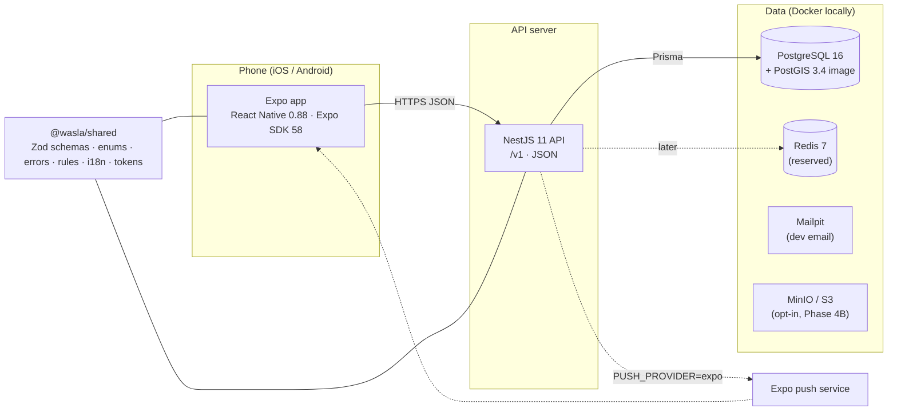

# 1. Tech stack

Everything is TypeScript, in one repository, so the mobile app, the API and the rules they share are
type-checked against each other. Versions are the ones installed in `pnpm-lock.yaml` at the time of
writing.

## Overview

## Repository and tooling

| Tool | Version | Role | Why |
|---|---|---|---|
| **pnpm** | 9.15.0 | Package manager and workspaces (`apps/*`, `packages/*`) | Fast, strict, disk-efficient; workspaces let the app and API import `@wasla/shared` directly |
| **Turborepo** | 2.x | Runs `build`, `test`, `typecheck` across packages in dependency order with caching | Small config, understands pnpm workspaces |
| **TypeScript** | 5.7 | All code | One language end to end; strict mode plus `noUncheckedIndexedAccess` (see `tsconfig.base.json`) |
| **Node.js** | 22.13+ required (`.nvmrc` = 22) | Runtime for API, tooling, Metro | Expo SDK 58 requires Node ≥ 22.13. The API alone runs on Node 20 |
| **Docker Compose** | — | Local PostgreSQL, Redis, Mailpit, optional MinIO | Same services on every machine, no local installs |

`.npmrc` sets `node-linker=hoisted`. React Native's Metro bundler and several Expo native modules
expect a flat `node_modules`; pnpm's default symlinked layout breaks them.

## API (`apps/api`)

| Technology | Version | Used for |
|---|---|---|
| **NestJS** | 11 | Web framework: modules, dependency injection, controllers, guards, pipes, filters |
| **Express** (via `@nestjs/platform-express`) | 5 | HTTP server underneath Nest |
| **Prisma** | 6.19 | Database schema, migrations, typed client. Raw SQL (`$queryRaw`) where Prisma can't express something (row locks, distance search, Arabic normalisation) |
| **PostgreSQL** | 16 (image `postgis/postgis:16-3.4`) | Main database. Also enforces integrity rules with CHECK constraints, partial unique indexes and triggers |
| **Zod** | 3.24 | Validates every request body/query through the shared schemas (`ZodPipe`) and the environment (`env.ts`) |
| **@nestjs/jwt** | 11 | Signs and verifies short-lived access tokens (HS256) |
| **@nestjs/throttler** | 6.4 | Per-IP rate limits (global 120/min; tighter on OTP, booking, publishing, chat) |
| **helmet** | 8 | Secure HTTP headers |
| **nestjs-pino / pino** | 4 / 9 | Structured JSON logs with request ids; redacts tokens, OTP codes and response bodies |
| **@nestjs/swagger** | 11 | Interactive API docs at `/docs` (disabled in production) |
| **Node `crypto`** | built-in | HMAC-SHA256 for OTP codes, SHA-256 for refresh tokens, `randomInt`/`randomBytes`, `timingSafeEqual`, `scrypt` for admin passwords |
| **Jest + Supertest** | 29 / 7 | Unit tests and end-to-end HTTP tests against a real database |
| **tsx** | 4 | Runs the TypeScript seed script directly |

**Why a modular monolith?** One deployable keeps Phase 2–4 simple (one database transaction can
cover a booking, its seat count, its audit entry and its notification). Each feature is a separate
Nest module (`auth`, `users`, `locations`, `rides`, `chat`, `notifications`) with its own service, so
any of them can be split out later if load demands it.

**Why not PostGIS functions yet?** The image includes PostGIS, but distance search uses a small SQL
function (`wasla_distance_km`, great-circle formula) plus a bounding-box prefilter on an index. That's
plenty for city-scale search and avoids a geometry column migration until maps arrive.

## Mobile app (`apps/mobile`)

| Technology | Version | Used for |
|---|---|---|
| **Expo SDK** | 58 | Toolchain, native modules, Expo Go for development |
| **React Native** | 0.88.1 | UI runtime (iOS + Android) |
| **React** | 19.3 | Components |
| **Expo Router** | 58 | File-based navigation (`app/` folder = routes), typed links, modals |
| **TanStack Query** | 5 | Server state: fetching, caching, polling (`refetchInterval`), invalidation after mutations |
| **Zustand** | 5 | Small client stores: auth session, onboarding answers, trip draft |
| **react-hook-form + @hookform/resolvers** | 7 | Installed for larger forms; not used yet — current forms use `useState`, and the API validates with the shared Zod schemas, returning per-field error codes the app shows under each field |
| **i18next + react-i18next** | 27 / 18 | Arabic/English strings from `@wasla/shared` |
| **expo-localization** | 58 | Device language on first launch |
| **expo-secure-store** | 58 | Refresh token and language choice, in the Keychain/Keystore |
| **expo-updates** | 58 | `reloadAsync()` to apply a right-to-left/left-to-right switch |
| **react-native-svg** | 15.16 | Icon set and logo (drawn, no image assets) |
| **@expo-google-fonts** | — | Readex Pro (display, numbers) and IBM Plex Sans Arabic (body) |
| **expo-location, expo-notifications** | 58 | Installed; used by the onboarding permission screen. Push token registration is Phase 4B |

**Why Expo SDK 58?** Expo Go (the app testers install from the stores) only runs the latest SDK. Using
it means anyone can run the app on a real phone without building native code. The trade-off is the
Node 22.13+ requirement.

**Why no native date picker or map yet?** Everything in the app currently runs inside Expo Go. The
date and time choosers are built from plain components (`DayChips`, `TimeChooser`), and places are
picked from the landmark list. Maps need a provider key (Phase 4B).

## Admin console (`apps/admin`)

| Technology | Version | Used for |
|---|---|---|
| **Vite** + `@vitejs/plugin-react` | 6 / 4 | Dev server (port 3000, proxies `/v1` to the API) and production build |
| **React** + **react-dom** | 19.3 | UI |
| **TanStack Query** | 5 | Data fetching and cache |

**Why Vite rather than Next.js (the earlier plan)?** The console is an internal tool behind a sign-in:
it needs no server-side rendering or SEO. A static single-page app is smaller, has fewer moving parts,
and can be served from the same domain as the API so its session cookie stays first-party. Details in
[Admin console](12-admin-console.md).

## Shared package (`packages/shared`)

Compiled to CommonJS in `dist/` and imported as `@wasla/shared` by both apps.

| Module | Contents |
|---|---|
| `schemas.ts` | Zod schemas for every request (the API validates with them; the app imports their input types and limits) |
| `enums.ts` | Enum values mirrored in the Prisma schema |
| `errors.ts` | Every error code with Arabic and English messages |
| `rides.ts` | Ride/price/search rules, distance and price helpers, plate formats |
| `phone.ts` | Egyptian mobile normalisation, validation, carrier, masking |
| `api-types.ts` | Response shapes (DTOs) |
| `i18n/en.ts`, `i18n/ar.ts` | All UI strings; Arabic is type-checked to have exactly the English keys |
| `tokens.ts` | Design tokens copied from the design canvas |

Tests run with **Vitest** 2.

## Design system

Tokens in `packages/shared/src/tokens.ts` come from the "Design system & tokens" board of the Wasla
design canvas:

| Token | Value | Use |
|---|---|---|
| Nile Teal (`primary`) | `#0B6E5F` | Buttons, links, pickup ring |
| Deep Teal (`primaryPressed`) | `#06302B` | Pressed states, text on mint |
| Sun Amber (`accent`) | `#F2A33A` | Destination dot, highlights (fill only, never text on white) |
| Ink (`text`) | `#0F1C1A` | Body text |
| Mist (`ground`) | `#F4F6F5` | Screen background |
| Spacing | 4 · 8 · 12 · 16 · 20 · 24 · 32 · 48 | `space.xxs` … `space.xxxl` |
| Radius | tag 8 · icon 14 · button 16 · card 20 · sheet 28 | |
| Touch target | ≥ 44 px | All buttons and rows |

Fonts: **Readex Pro** for headings and numbers, **IBM Plex Sans Arabic** for body text in both
languages (it has good Latin glyphs too). Arabic text gets +2 px line height.

## Local infrastructure (`docker-compose.yml`)

| Service | Image | Port(s) | Notes |
|---|---|---|---|
| postgres | `postgis/postgis:16-3.4` | 5432 | User `wasla`, password `wasla_local_dev` (local only). `infra/postgres/init/01-test-db.sql` creates `wasla_test` on first start |
| redis | `redis:7-alpine` | 6379 | Reserved for shared rate limits and jobs; not used by code yet |
| mailpit | `axllent/mailpit` | 1025 (SMTP), 8025 (web) | Catches dev emails; not used yet |
| minio | `minio/minio` | 9000, 9001 | Behind the `storage` profile — the image is no longer on Docker Hub (see [development log](10-development-log.md#minio-image-no-longer-on-docker-hub)) |

## Considered and not chosen

| Option | Why not (for now) |
|---|---|
| Microservices | Too much operational cost for the team size; a booking must update several tables atomically |
| GraphQL | REST with shared Zod types already gives end-to-end typing; simpler caching and rate limiting |
| Firebase / Supabase | Business rules (seat locking, roles, price caps) must live on a server we control |
| WebSockets for chat | Polling is enough at launch scale and works through any network; sockets come later |
| Native date/map pickers | Would require leaving Expo Go for custom dev builds this early |
| Storing money as decimals | Integers in piasters avoid rounding errors (`4500` = 45 EGP) |
