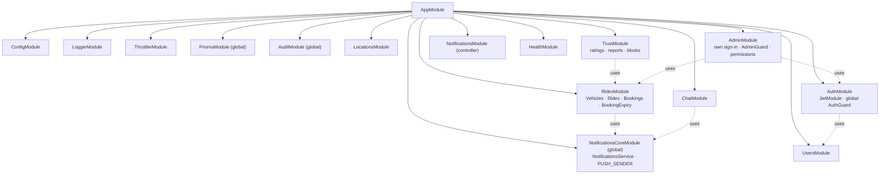
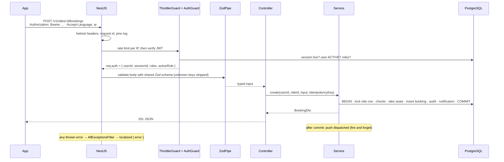
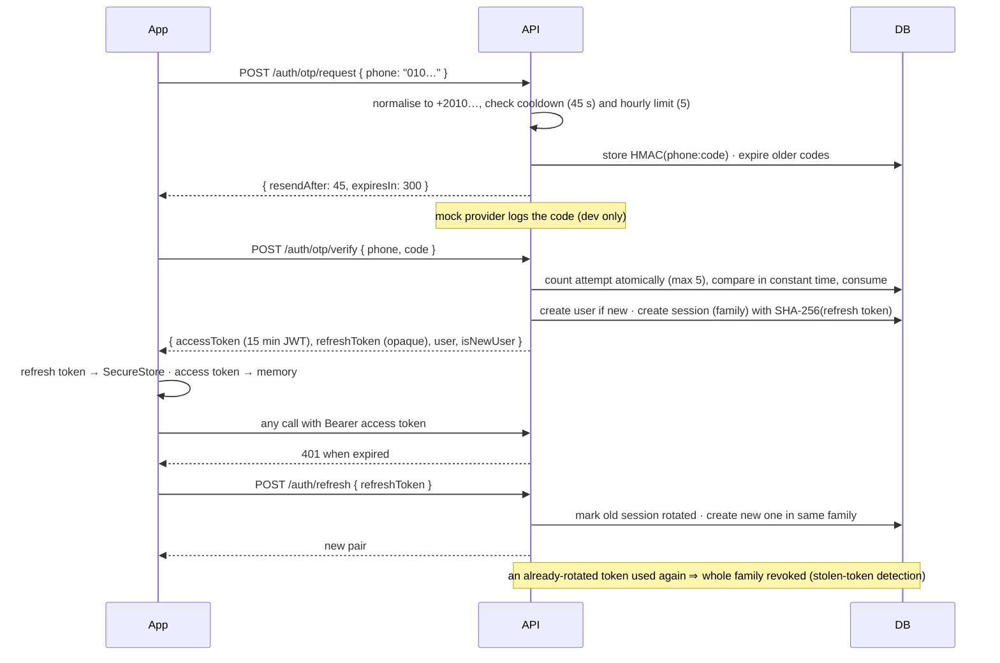
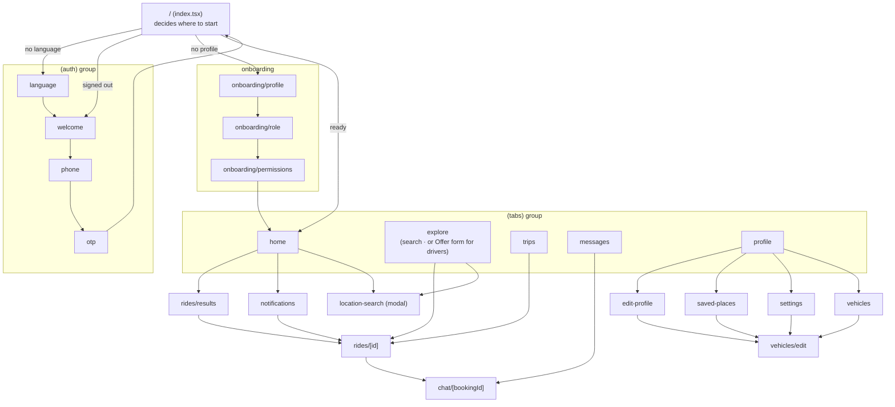
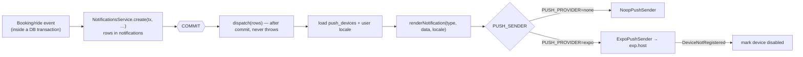

# 2. Architecture

## Repository layout

```
Wasla/
├── apps/
│   ├── api/                  NestJS API
│   │   ├── prisma/           schema, migrations, seed
│   │   ├── src/              modules (see below)
│   │   └── test/             end-to-end tests
│   ├── admin/                staff console (Vite + React)
│   └── mobile/               Expo app
│       ├── app/              screens — the folder structure IS the navigation
│       └── src/              API client, components, hooks, stores, formatting
├── packages/
│   └── shared/               code used by both apps (schemas, rules, strings, tokens)
├── infra/postgres/init/      SQL run when the database container is first created
├── docs/                     this documentation
├── docker-compose.yml        local services
├── turbo.json                build pipeline
└── pnpm-workspace.yaml       workspace list
```

## API module map



Global providers registered in `AppModule`:
- `ThrottlerGuard` (rate limits) and `AuthGuard` (authentication) as `APP_GUARD`s.
- `AllExceptionsFilter` as `APP_FILTER`: every error becomes `{ error: { code, message, … } }`.

## Lifecycle of a request



Key points:
1. **The client never decides who it is.** `@CurrentUser()` reads `req.auth`, which only the
   `AuthGuard` sets after checking the token *and* the database. Roles in a request body are stripped
   by `ZodPipe` and never read.
2. **Validation happens once, at the edge,** with the shared schema; field errors come back as codes
   (`fields: { plateDigits: 'VEHICLE_PLATE_FORMAT' }`) that the app shows under the right input.
3. **Errors are codes.** Services throw `AppException('BOOKING_NOT_ENOUGH_SEATS', 409)`; the filter
   turns that into a message in the caller's language. Apps branch on `code`, never on text.

## Authentication



- **Access token:** JWT HS256, 15 minutes, payload `{ sub: userId, sid: sessionId }`, issuer
  `wasla-api`. Checked against the `sessions` table on every request, so logout and suspension take
  effect immediately rather than when the token expires.
- **Refresh token:** 48 random bytes (base64url), stored only as a SHA-256 hash, 30-day life, single
  use. Each use creates the next session in the same `familyId`.
- **On the phone:** the refresh token lives in SecureStore; the access token only in memory. Parallel
  401s share one refresh (`ensureFreshSession` single-flight).

## Mobile navigation

The `app/` folder is the route tree (Expo Router):



## Client state

| Kind of state | Where it lives | Examples |
|---|---|---|
| Server data | TanStack Query cache, keyed by resource | `['ride', id]`, `['bookings', scope]`, `['conversations']`, `['notifications','unread']` |
| Session | Zustand `useAuth` + SecureStore | status, `me`, pending phone during OTP |
| Drafts across screens | Zustand `useTripDraft` | from/to for search, from/to for the Offer form, date, seats |
| Onboarding answers | Zustand `useOnboarding` | name, birth date, gender (sent with the role choice in one request) |
| Form fields | `useState` in the screen | Booking seats, pickup note, car fields, Offer form |

After every mutation, the app invalidates the affected query keys (`bookings`, `rides`, `me`,
`conversations`, the ride itself) so lists refresh without manual reloading.

## Data integrity: defence in depth

Every important rule is enforced in at least two places:

| Rule | API code | Database |
|---|---|---|
| No overbooking | Ride row lock + conditional `UPDATE … WHERE seats_available >= n` | `CHECK (seats_available BETWEEN 0 AND seats_total)` |
| One active booking per passenger per ride | Check under lock | Partial unique index `bookings_one_active_per_passenger` |
| Retried booking requests | `Idempotency-Key` lookup before and under the lock | Unique `(passenger_id, idempotency_key)` |
| Money adds up | `total = price × seats` computed server-side | `CHECK (total_piasters = seats * price_per_seat_piasters)` |
| Roles | Guard reloads roles; `setActiveRole` checks grants | `CHECK ('PASSENGER' = ANY(roles))`, `CHECK (active_role = ANY(roles))` |
| One car per plate | Unique-violation mapped to `VEHICLE_PLATE_TAKEN` | Partial unique index on active plates |
| Audit trail can't be rewritten | Only inserts in code | Trigger blocks UPDATE/DELETE on `audit_logs` |
| Chat history can't be edited | No edit endpoint | Trigger blocks UPDATE on `messages` |
| OTP brute force | Atomic attempt counter | `CHECK (attempts BETWEEN 0 AND 5)` |

## Concurrency model for bookings

```mermaid
sequenceDiagram
  participant A as Passenger A
  participant B as Passenger B
  participant DB
  A->>DB: BEGIN; SELECT … FROM rides WHERE id=R FOR UPDATE
  B->>DB: BEGIN; SELECT … FROM rides WHERE id=R FOR UPDATE (waits)
  A->>DB: checks · UPDATE rides SET seats_available = seats_available - 1 WHERE … AND seats_available >= 1
  A->>DB: INSERT booking · audit · notification · COMMIT
  DB-->>B: lock granted, sees A's committed row
  B->>DB: checks (now 0 seats) → BOOKING_NOT_ENOUGH_SEATS · ROLLBACK
```

All writes that change seats (book, cancel, decline, expire, driver edits) take the same ride row lock,
so they run one at a time *per ride* while different rides proceed in parallel. The end-to-end tests
fire 8 bookings at a 3-seat ride simultaneously and check exactly 3 succeed.

## Notifications and push



The inbox row is the source of truth; push is a best-effort copy. A failed push never fails or rolls
back the booking.

## Background work

`BookingExpiryService` runs every 60 seconds in each API instance (not in tests). It finds pending
requests past `expires_at`, and for each one locks the ride, re-checks the booking is still pending,
marks it `EXPIRED`, returns the seats and notifies the passenger. Running it on several instances at
once is safe because of the lock and re-check.

## Blocking

Blocks are checked by plain functions in `src/trust/block-check.ts` (`isBlockedEither`, `blockedSet`,
`notBlockedSql`) rather than an injected service, so rides, bookings and chat can use them without a
circular module dependency. Once either person blocks the other:

| Place | Effect |
|---|---|
| Search | The other person's rides are filtered out in SQL |
| Ride details | 404, unless there is already a booking between them |
| Booking | Refused with the neutral `RIDE_NOT_AVAILABLE` |
| Chat | Readable, but closed for sending |
| Existing bookings | Active bookings between them on rides that haven't left are cancelled, seats returned, the other side told their booking ended (never that they were blocked) |

## Admin console

A separate staff app (`apps/admin`) with its own accounts, cookie session, CSRF header and role
permissions. See [Admin console](12-admin-console.md) for the full flow.
