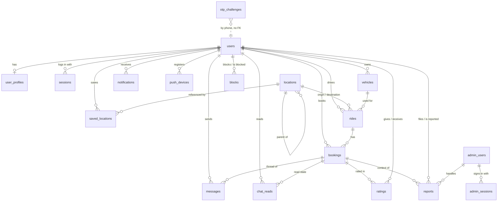
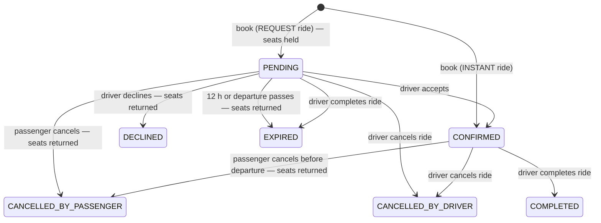

# 3. Database

PostgreSQL 16. Schema source of truth: [`apps/api/prisma/schema.prisma`](../apps/api/prisma/schema.prisma).
Rules Prisma can't express are hand-written at the end of each migration file.

Conventions:
- Primary keys are UUIDs (`gen` by Prisma); `audit_logs` uses a `BIGSERIAL` for ordering.
- Column names are `snake_case` in SQL, `camelCase` in TypeScript (`@map`).
- Timestamps are UTC. Ride departure and booking expiry are `timestamptz` because search converts
  them to Egyptian calendar days (`AT TIME ZONE 'Africa/Cairo'`).
- Money is an integer number of **piasters** (100 piasters = 1 EGP).
- Coordinates are WGS84 `double precision` latitude/longitude.

## Entity relationships

`admin_users` and `audit_logs` stand alone (audit rows reference entities by type + id text so they
survive deletions).

## Enums

| Enum | Values |
|---|---|
| `UserRole` | `PASSENGER`, `DRIVER` |
| `UserStatus` | `ACTIVE`, `SUSPENDED`, `DELETED` |
| `Gender` | `FEMALE`, `MALE` |
| `Locale` | `ar`, `en` |
| `OtpPurpose` | `LOGIN` |
| `LocationKind` | `GOVERNORATE`, `CITY`, `DISTRICT`, `NEIGHBORHOOD`, `COMPOUND`, `GATE`, `LANDMARK`, `UNIVERSITY`, `MALL`, `BUSINESS_DISTRICT`, `TRANSIT` |
| `SavedLocationLabel` | `HOME`, `WORK`, `OTHER` |
| `RideStatus` | `SCHEDULED`, `CANCELLED`, `COMPLETED` |
| `BookingMode` | `INSTANT`, `REQUEST` |
| `BookingStatus` | `PENDING`, `CONFIRMED`, `DECLINED`, `CANCELLED_BY_PASSENGER`, `CANCELLED_BY_DRIVER`, `EXPIRED`, `COMPLETED` |
| `PaymentMethod` | `CASH` |
| `NotificationType` | `BOOKING_REQUESTED`, `BOOKING_CONFIRMED`, `BOOKING_ACCEPTED`, `BOOKING_DECLINED`, `BOOKING_EXPIRED`, `BOOKING_CANCELLED`, `RIDE_CANCELLED`, `RIDE_COMPLETED` |
| `ReportReason` | `SAFETY`, `HARASSMENT`, `INAPPROPRIATE_MESSAGES`, `NO_SHOW`, `PAYMENT`, `FAKE_PROFILE`, `OTHER` |
| `ReportStatus` | `OPEN`, `IN_REVIEW`, `RESOLVED`, `DISMISSED` |
| `AdminRole` | `SUPER_ADMIN`, `OPERATIONS`, `SUPPORT`, `FINANCE` |
| `ActorType` | `USER`, `ADMIN`, `SYSTEM` |

The same values live in `packages/shared/src/enums.ts` so the apps use identical strings.

## Tables

### Identity

**`users`** — one person; can be passenger and driver.

| Column | Type | Notes |
|---|---|---|
| id | uuid PK | |
| phone_e164 | varchar(16) unique | `+201XXXXXXXXX`, normalised by the shared phone code |
| email | varchar(254) unique, null | Not used yet |
| roles | `UserRole[]` default `{PASSENGER}` | Granted by the backend only |
| active_role | `UserRole` default `PASSENGER` | Which experience the app shows |
| status | `UserStatus` default `ACTIVE` | Checked on every request |
| locale | `Locale` default `ar` | Language for push text |
| phone_verified_at, suspended_reason, created_at, updated_at, deleted_at | | |

Checks: `'PASSENGER' = ANY(roles)`; `active_role = ANY(roles)`.

**`user_profiles`** — 1:1 with users (PK = `user_id`).
`full_name` (≤80), `date_of_birth` (date), `gender`, `bio` (≤280), `photo_key` (Phase 4B),
preferences `pref_quiet`, `pref_music_ok`, `pref_ac`, `pref_smoking_ok`, privacy
`show_gender`, `show_full_last_name`.

**`sessions`** — one row per refresh token.
`family_id` groups a login's chain of rotations; `refresh_token_hash` char(64) unique (SHA-256);
`device_name`, `user_agent`, `ip`, `expires_at`, `rotated_at` (set when exchanged), `revoked_at`.
Indexes: `user_id`, `family_id`.

**`otp_challenges`** — login codes. `phone_e164`, `purpose`, `code_hash` char(64) (HMAC-SHA256 of
`phone:code`), `attempts`, `expires_at`, `consumed_at`, `ip`. Check: `attempts BETWEEN 0 AND 5`.
Index: `(phone_e164, created_at)`.

### Places

**`locations`** — Egyptian places in a tree (governorate → city → district → compound → gate).
`slug` unique (stable seed key, e.g. `cairo.new-cairo.cfc.gate-4`), `kind`, `name_en`, `name_ar`,
`aliases text[]` (abbreviations and spellings: "CFC", "التجمع"), `parent_id`, `lat`, `lng` (nullable
for areas without a point), `popularity` (tie-break in search), `is_active`.
Checks on coordinate ranges. Indexes: `kind`, `parent_id`.

**`saved_locations`** — a user's Home/Work/other places. `label`, `custom_name` (OTHER only),
`location_id` (optional link), `lat`, `lng` (always set), `pickup_note`.
Partial unique index `saved_locations_one_home_work_per_user` on `(user_id, label) WHERE label IN
('HOME','WORK')`.

### Rides

**`vehicles`** — `owner_id`, `make`, `model`, `color`, `year`, `seats` (passenger seats),
`plate_letters` ("أ ب ج"), `plate_digits` ("1234"), `is_active` (soft delete), `verified_at`
(Phase 5).
Checks: seats 1–6, year 1990–2100, digits `^[0-9]{1,4}$`.
Partial unique index `vehicles_active_plate_unique` on `(plate_letters, plate_digits) WHERE is_active`.

**`rides`** — one offered trip.

| Column | Notes |
|---|---|
| driver_id, vehicle_id | FKs (restrict delete) |
| status | `SCHEDULED` → `CANCELLED` or `COMPLETED` |
| departure_at | `timestamptz(3)` |
| origin_location_id, origin_name_en/ar, origin_lat/lng | Names are copied so a ride keeps its text if a place is renamed; a map pin stores its label in both name columns |
| destination_* | Same for the destination |
| distance_km | Straight-line distance at publish time (drives price limits) |
| seats_total, seats_available | Kept in step with active bookings inside transactions |
| price_per_seat_piasters | |
| booking_mode | `INSTANT` or `REQUEST` |
| women_only | |
| notes, pref_* | Snapshot of the driver's preferences, overridable per ride |
| cancelled_at, cancel_reason, completed_at | |

Checks: `seats_total BETWEEN 1 AND 6`; `seats_available BETWEEN 0 AND seats_total`; price > 0;
coordinate ranges.
Indexes: `(status, departure_at)`, `(driver_id, departure_at)`, and partial
`rides_open_origin_box (origin_lat, origin_lng) WHERE status = 'SCHEDULED'` for the search bounding box.

**`bookings`** — a passenger's seats on a ride.
`status`, `seats`, `price_per_seat_piasters` (snapshot), `total_piasters`, `payment_method`,
`pickup_note`, `idempotency_key`, `expires_at` (pending requests), `decided_at`, `cancelled_at`,
`cancel_reason`.
Checks: seats 1–4; `total_piasters = seats * price_per_seat_piasters`.
Unique `(passenger_id, idempotency_key)`. Partial unique `bookings_one_active_per_passenger` on
`(ride_id, passenger_id) WHERE status IN ('PENDING','CONFIRMED')`.
Indexes: `(ride_id, status)`, `(passenger_id, status)`, `(status, expires_at)`.

Booking lifecycle:

### Messaging and notifications

**`notifications`** — inbox. `user_id`, `type`, `ride_id`, `booking_id`, `data jsonb` (display
name, place names, departure time — never phone numbers), `read_at`.
Index `(user_id, created_at DESC)`.

**`push_devices`** — Expo push tokens. `token` unique (moves to whoever registers it last),
`platform` (`ios`/`android`, checked), `disabled_at` (set when Expo reports the app uninstalled),
`last_seen_at`.

**`messages`** — chat lines. `booking_id`, `sender_id`, `body` (≤1000), `created_at timestamptz`.
Check: body not blank. Trigger `messages_no_update` rejects any UPDATE. Index `(booking_id, created_at)`.

**`chat_reads`** — `(booking_id, user_id)` PK, `last_read_at`. Unread = messages from the other
person after this time.

### Trust and safety

**`ratings`** — `booking_id`, `rater_id`, `ratee_id`, `stars` (1–5), `tags text[]` (≤ 4),
`comment` (≤ 280, staff-only). Unique `(booking_id, rater_id)`: one rating per person per trip.
Checks: stars range, not rating yourself, tag count. Index `(ratee_id, created_at)`.

**`reports`** — `reporter_id`, `reported_user_id`, `booking_id`, `reason`, `details` (≤ 1000),
`status`, `admin_note`, `handled_by_id` (admin), `resolved_at`. Check: not reporting yourself.
Partial unique index `reports_one_open_per_booking` on `(reporter_id, booking_id) WHERE status IN
('OPEN','IN_REVIEW')`. Indexes on `(status, created_at)`, `reported_user_id`, `(reporter_id, created_at)`.

**`blocks`** — `(blocker_id, blocked_id)` primary key, `created_at`. Check: not blocking yourself.

### Administration

**`admin_users`** — staff accounts for the console. `email`, `name`, `password_hash`
(scrypt), `role`, `disabled_at`, `last_login_at`, `failed_logins`, `locked_until`.

**`admin_sessions`** — `admin_id`, `token_hash` (SHA-256 of the cookie token, unique), `ip`,
`user_agent`, `expires_at` (8 h), `revoked_at`.

**`audit_logs`** — append-only record. `actor_type`, `actor_id`, `action` (e.g. `RIDE_PUBLISHED`,
`BOOKING_CANCELLED`, `auth.refresh_token_reuse`), `entity_type`, `entity_id`, `metadata jsonb`, `ip`.
Trigger `audit_logs_no_update` rejects UPDATE and DELETE.
Indexes: `(entity_type, entity_id)`, `(actor_type, actor_id)`, `created_at`.

## Functions

`wasla_distance_km(lat1, lng1, lat2, lng2) → double precision` — great-circle distance in km,
`IMMUTABLE PARALLEL SAFE`. Same formula as `distanceKm()` in the shared package so the app's price
hint and the server's check agree.

## Migrations

| Folder | Adds |
|---|---|
| `20261117120000_init` | Identity, sessions, OTP, places, saved places, admins, audit log; checks on roles, attempts, coordinates; one Home/Work per user; append-only audit trigger |
| `20261118100000_rides_bookings` | Vehicles, rides, bookings; seat/price/money checks; one active booking per passenger; active plate uniqueness; `wasla_distance_km`; search index |
| `20261118140000_messaging_notifications` | Notifications, push devices, messages, chat reads; non-blank and no-edit rules for messages |
| `20261118180000_trust_safety_admin` | Ratings, reports, blocks, admin sessions, admin lockout columns; one open report per trip; no self-rating, -reporting or -blocking |

How they were produced: `prisma migrate diff` generated the table SQL, then the hand-written section
was appended under a clear comment. Apply with `pnpm db:migrate` (dev) or `prisma migrate deploy`
(CI/production). Never edit a migration that has been applied anywhere; add a new one.

## Seed data (`prisma/seed/`)

`pnpm db:seed` runs `index.ts`. It is **idempotent** (upserts; skips rides if the drivers already have
upcoming ones) and **refuses to run with `NODE_ENV=production`**.

- `locations.ts` — `SEED_PLACES`: 27 governorates plus cities, districts and ~32 specific pickup
  places (Smart Village B2 and Main Gate, Cairo Festival City Gate 4, Point 90, City Stars Gate 5, AUC,
  GUC, Rehab Gates 13 and 6, Tahrir, Ramses, Sidi Gaber station…). **Coordinates are approximate** and
  must be checked before launch.
- Users: `+201000000001` Nour El-Sayed (passenger), `+201000000002` Karim Mostafa (passenger +
  driver), `+201000000003` Youssef Samir (passenger + driver, English), each with Home and Work.
- Cars and rides: Karim's Elantra (Smart Village B2 ⇄ CFC Gate 4, instant) and Youssef's Cerato
  (Rehab Gate 13 → Tahrir, request mode), departing within the next ~30 hours of seeding.
- A `SUPER_ADMIN` for the console is created only if `SEED_ADMIN_EMAIL` and `SEED_ADMIN_PASSWORD`
  (12+ characters) are set.

## Test database

`wasla_test` (created by `infra/postgres/init/01-test-db.sql`). Every end-to-end run migrates it,
truncates all user data (`TRUNCATE users, otp_challenges, audit_logs, admin_users … CASCADE`) and
re-seeds. The setup refuses to run against a database whose name doesn't end in `_test`.
