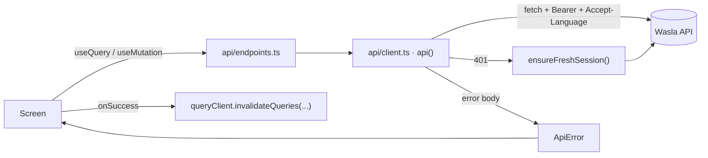

# 7. Code reference — mobile app (`apps/mobile`)

Expo Router turns the `app/` folder into screens: a file is a route, a folder in parentheses is a
group that doesn't appear in the URL, and `_layout.tsx` wraps its siblings. Paths below are relative to
`apps/mobile`.

## Configuration

| File | Purpose |
|---|---|
| `package.json` | Dependencies pinned to the versions Expo SDK 58 expects; `main` is `expo-router/entry` |
| `app.json` | App name, bundle id / package `app.wasla.mobile`, plugins (router, secure store, localization, location with its permission text, notifications, splash screen in Nile Teal), supported locales |
| `locales/en.json`, `locales/ar.json` | Native strings (app name, permission prompts) shown by iOS/Android outside the app |
| `tsconfig.json` | Extends `expo/tsconfig.base` |
| `.env.example` → `.env` | `EXPO_PUBLIC_API_URL` (address the phone uses to reach the API), plus placeholders for `EAS_PROJECT_ID` and a Maps key |

## Routes (`app/`)

### Root

| File | Screen / role |
|---|---|
| `_layout.tsx` | **`RootLayout`** — loads fonts and translations, creates the `QueryClient` (30 s stale time; no retries for 4xx errors), runs `useAuth.bootstrap()`, keeps the splash screen until ready, defines the stack with `location-search` as a modal |
| `index.tsx` | **`Index`** — decides where to start: no language chosen → `/language`; signed out → `/welcome`; no profile → `/onboarding/profile`; otherwise `/home`. If the phone was offline at launch, shows a retry instead of signing the user out |

### `(auth)` — signing in

| File | Screen | What it does |
|---|---|---|
| `_layout.tsx` | `AuthLayout` | Stack without headers |
| `language.tsx` | `LanguageScreen` (+ `LanguageOption`) | First launch: Arabic or English. `setLanguage()` saves it and reloads the app if the layout direction must change |
| `welcome.tsx` | `Welcome` (+ `Point`) | Logo, three value points, "Get started" → phone |
| `phone.tsx` | `PhoneScreen` (+ `Flag`) | Egyptian number input with a drawn flag and +20 prefix; normalises any format, shows the carrier (Vodafone, e&, Orange, WE) as you type; requests a code. If a code was sent moments ago (`AUTH_OTP_COOLDOWN`) it continues to the code screen instead of failing |
| `otp.tsx` | `OtpScreen` | Six boxes driven by one hidden input (so SMS autofill and paste work; always left-to-right); auto-submits at 6 digits; resend countdown; on a locked or expired code allows an immediate resend; shows a dev-only hint about the mock code |

### `onboarding/` — first-time profile

| File | Screen | What it does |
|---|---|---|
| `_layout.tsx` | `OnboardingLayout` | Stack |
| `profile.tsx` | `ProfileStep` (+ `formatDob`) | Name, birth date (auto-inserts dashes), gender; stored in `useOnboarding` |
| `role.tsx` | `RoleStep` (+ `Choice`) | Passenger is always on; "I also drive" toggles the driver role; ride-preference chips. Sends name, birth date, gender, preferences and the driving choice in **one** `POST /me/profile`. If reached directly (e.g. after a restart) it redirects to step 1 |
| `permissions.tsx` | `PermissionsStep` (+ `PermissionCard`) | Explains and requests location and notification permission; both optional |

### `(tabs)` — main app

| File | Screen | What it does |
|---|---|---|
| `_layout.tsx` | `TabsLayout` | Five tabs; redirects if signed out or without a profile. The second tab is "Explore" for passengers and "Offer" for drivers. Messages tab shows the unread badge (`useUnreadMessages`) |
| `home.tsx` | `Home` (+ `greetingKey`) | Greeting, **bell with unread count** → notifications, passenger/driver switch (turning on driving if needed), then either the `SearchCard` (passenger) or Offer/My rides buttons (driver). Prefills Home → Work from saved places; saved places as chips |
| `explore.tsx` | `Explore` | Passenger: `SearchCard`. Driver: `OfferForm` |
| `trips.tsx` | `Trips` | Booked / Driving switch (if the user drives), Upcoming / Past; ride cards with booking status, seats and total, or booked-of-total for drivers; pull to refresh |
| `messages.tsx` | `Messages` | Conversations list (other person, their role, ride, last message, unread badge), polled every 15 s |
| `profile.tsx` | `Profile` (+ `Stat`) | Avatar, member since, trips and rating stats, links to personal info, saved places, **My cars** (drivers), settings |

### Rides, chat and other screens

| File | Screen | What it does |
|---|---|---|
| `rides/results.tsx` | `Results` | Calls `ridesApi.search` with the draft (from, to, date, seats); list of `RideCard`s; empty state with "Change search" |
| `rides/[id].tsx` | `RideDetail` | The ride: time, route, price, tags, driver, car and plate (when allowed), notes, preferences. Then **`PassengerPanel`** or **`DriverPanel`** (below) |
| `chat/[bookingId].tsx` | `Chat` | Safety note, messages (inverted list), "Seen" on your last message, composer (1000 chars). Loads the latest page, then polls every 4 s with `after=<last id>`; marks read when new messages arrive. Shows "chat closed" instead of the composer when closed |
| `notifications.tsx` | `Notifications` | Infinite list (pages of 30), unread rows highlighted, tap marks read and opens the ride, check icon marks all read |
| `location-search.tsx` | `LocationSearch` (modal) | Debounced (250 ms) landmark search with kind icons. `purpose` param decides the result: `from`/`to`/`offerFrom`/`offerTo` fill the trip draft; `HOME`/`WORK`/`OTHER` save a place |
| `saved-places.tsx` | `SavedPlaces` | Home, Work, other places; set, replace, remove |
| `edit-profile.tsx` | `EditProfile` | Name, bio, preferences |
| `settings.tsx` | `Settings` | Language (saves on the server first so push follows it, then may reload), privacy toggles, log out |
| `rate/[bookingId].tsx` | `Rate` (+ `Stars`) | Five tappable stars, role-appropriate tags (max 4), optional staff-only comment; shows your existing rating, or why rating isn't open |
| `report.tsx` | `Report` | Params `bookingId`, `userId`, `name`. Tap-to-call police (122), reason list, details, "also block" toggle; confirmation screen |
| `safety.tsx` | `Safety` | Emergency numbers (122 police, 123 ambulance) with call buttons, how to report, safety tips, link to blocked people |
| `blocked-users.tsx` | `BlockedUsers` | People you blocked, with unblock (confirmation) |
| `vehicles/index.tsx` | `Vehicles` | The driver's cars; add button |
| `vehicles/edit.tsx` | `EditVehicle` | Add (no `id`) or edit a car: make, model, colour, year, seats stepper, plate letters and numbers; per-field errors from the API; remove with confirmation |

#### Inside `rides/[id].tsx`

- **`useRefreshLists()`** — invalidates `bookings`, `rides` and `me` queries after any change.
- **`openChat(bookingId)`**, **`openRate(bookingId)`**, **`openReport(bookingId, userId, name)`**,
  **`confirm(title, body, yes, no, onYes)`** (native alert for destructive actions).
- **`useReputation()`** — "★ 4.6 (12) · Trips: 30" or "New on Wasla" for the driver card.
- **`PassengerPanel`** —
  - With an active booking: status, explanation (for pending: until when the driver can answer), seats
    and total, pickup note, cash notice, **Message** and **Cancel booking**.
  - Otherwise, on an open ride with seats: seat stepper (max 4 or seats left), pickup note, cash notice,
    live total, **Book** / **Send request**. Each attempt has an `Idempotency-Key` (`newIdempotencyKey()`)
    kept until success, so a retry never books twice.
  - Closed or full rides show a notice instead.
- **`DriverPanel`** — passengers list (`PassengerRow` each), seat editor (between booked and the car's
  seats), **Mark ride as done** after departure, **Cancel ride** with confirmation.
- **`PassengerRow`** — passenger display name, seats and total, status, pickup note, request expiry,
  **Message**, and **Accept** / **Decline** for pending requests.

## `src/` — shared app code

### `api/client.ts`
- **`ApiError(code, message, status, fields?, extra?)`** — every failed call throws this. Network
  failure → code `NETWORK`.
- **`tokenStore`** — `save(tokens)` (access token in memory, refresh token in SecureStore),
  `clear()`, `hasRefreshToken()`, `onSessionLost(fn)`.
- **`refreshTokens()`** (internal) — calls `/auth/refresh`; clears the session on 401/403, keeps it on
  network errors.
- **`ensureFreshSession()`** — single-flight wrapper: parallel callers share one refresh.
- **`api<T>(path, { method, body, query, auth, headers })`** — adds `Accept-Language`, bearer token
  and JSON headers; drops empty query values; on 401 refreshes once and retries; parses the error body
  into `ApiError`.
- **`fieldMessage(code)`** — localized text for a field error code.

### `api/endpoints.ts`
Typed wrappers, one object per area: **`authApi`** (`requestOtp`, `verifyOtp`, `logout`), **`meApi`**
(`get`, `createProfile`, `updateProfile`, `enableDriving`, `setActiveRole`), **`locationsApi`**
(`search`, `saved`, `save`, `remove`), **`vehiclesApi`** (`list`, `add`, `update`, `remove`),
**`ridesApi`** (`search`, `publish`, `get`, `update`, `cancel`, `complete`, `mine`), **`bookingsApi`**
(`create` with idempotency key, `mine`, `get`, `cancel`, `accept`, `decline`), **`notificationsApi`**
(`list`, `unreadCount`, `markRead`), **`chatApi`** (`conversations`, `unreadCount`, `messages`, `send`,
`markRead`).

### `i18n.ts`
- **`getStoredLanguage()`**, **`hasChosenLanguage()`** — from SecureStore key `wasla.language`.
- **`deviceLanguage()`** — English only if the phone is in English; otherwise Arabic.
- **`initI18n()`** — loads `en`/`ar` from the shared package; makes the native layout direction match
  (forces RTL for Arabic) and reloads if it had to change.
- **`setLanguage(lang)`** — saves, switches, reloads when direction changes.
- **`reloadApp()`** — `Updates.reloadAsync()`, falling back to `DevSettings.reload()` in dev builds.
- **`isRTL()`**.

### `format.ts`
- **`useFormat()`** — `time`, `day`, `dayTime` (Intl, `ar-EG` or `en-GB`), `money(piasters)`
  ("45 EGP" / "٤٥ ج.م"), `number`, `place(point)` (name in the current language), `ar` flag.
- **`nextDays(count)`** — upcoming days as `{ key: 'YYYY-MM-DD', date }`.
- **`newIdempotencyKey()`** — random `m-<time>-<random>` key (not a secret).

### `theme.ts`
Re-exports shared tokens and defines **`fonts`** (Readex Pro 500–700, IBM Plex Sans Arabic 400–700).

### Stores (`stores/`)

| Store | State and actions |
|---|---|
| `auth.ts` — **`useAuth`** | `status` (`loading`/`offline`/`signedOut`/`signedIn`), `me`, `pendingPhone`, `resendAfter`; **`bootstrap()`** (restore session from SecureStore; offline-safe), **`setPendingPhone()`**, **`signIn(result)`**, **`setMe()`**, **`signOut()`** (server logout best-effort, then clear). Subscribes to `tokenStore.onSessionLost` |
| `onboarding.ts` — **`useOnboarding`** | `fullName`, `dateOfBirth`, `gender`, `setIdentity()` |
| `trip-draft.ts` — **`useTripDraft`** | `from`, `to` (search), `offerFrom`, `offerTo` (publishing), `date`, `seats`; `set(field, place)`, `swap()`, `swapOffer()`, `setDate()`, `setSeats()`. Also **`localDateString(date)`**, **`DRAFT_FIELDS`**, **`DraftField`** |

### Hooks (`hooks/`)

| Hook | Purpose |
|---|---|
| `useSavedPlaces()` / `savedPlacesKey` | Query for the user's saved places |
| `usePlaceName()` | `name(location)`, `parent(location)`, `kind(location)`, `saved(savedPlace)` in the current language |
| `useUnreadNotifications()` | Unread notifications count, polled every 30 s |
| `useUnreadMessages()` | Unread chat messages, polled every 15 s |
| `useNotificationText()` | Turns a `NotificationDto` into a localized sentence |

### Components (`components/`)

**`ui.tsx`** — the design system:

| Component | Props / behavior |
|---|---|
| `T` | Text with variants (`h1`, `h2`, `h3`, `body`, `meta`, `caption`, `price`, `label`), `muted`, `weight`, `color`; sets writing direction from RTL state |
| `Button` | `kind`: `primary`, `secondary`, `tonal`, `danger`, `ghost`; `icon`, `loading`, `disabled`; 44 px+ touch height; accessibility state |
| `Card` | Surface with border; becomes pressable with `onPress` |
| `Field` | Labeled text input (forwards a ref) with `error`, `hint`, `prefix`, `suffix`; right-aligned in Arabic |
| `Chip` | Selectable pill with optional icon |
| `Segmented<V>` | Two-or-more option switch (radio group) |
| `ToggleRow` | Label + hint + switch |
| `Avatar` | Initials in a coloured circle |
| `Tag` | Small label: `teal`, `sand`, `blue`, `red`, `gray` |
| `Notice` | Icon + text banner: `info`, `warn`, `error`, `neutral` |
| `IconButton` | 44 px icon button with label |
| `Row` | List row with icon, title, subtitle, trailing element, `danger` |
| `Divider` | 1 px line |

**`Icon.tsx`** — **`Icon`** (`name`, `size`, `color`, `strokeWidth`) draws 24-px stroke icons in SVG:
home, search, calendar, chat, user, pin, shield, car, users, bell, back, chevron, check, close, swap,
lock, globe, gear, briefcase, logout, trash, edit, cash, plus, minus, send, clock. Directional icons
(`back`, `chevron`, `send`) are mirrored in Arabic. **`LogoMark`** draws the Wasla mark.

**`Screen.tsx`** — **`Screen`**: safe area, keyboard avoidance, optional header with back button and
title, optional `right` element, scrolling or fixed body, optional sticky `footer`.

**`rides.tsx`** — ride building blocks:

| Component | Purpose |
|---|---|
| `RouteLine` | Teal pickup ring → line → amber destination dot, with optional time |
| `StatusTag` | Localized, coloured tag for a booking or ride status |
| `RideCard` | Route, price, day, match distances, driver and car, women-only tag, seats left, optional footer |
| `Stepper` | − value + control with min/max and accessibility labels |
| `DayChips` | Today, Tomorrow, then dates, horizontally scrollable |
| `TimeChooser` | Time with −1h / −15 / +15 / +1h buttons (15-minute steps, wraps around midnight) |
| `EmptyState` | Icon, title, body, optional action |

**`SearchCard.tsx`** — **`PlaceSlot`** (one from/to row), **`PlacePair`** (from/to with swap, for any
pair of draft fields), **`SearchCard`** (places, day chips, seats, Search button; disabled until both
places are chosen).

**`OfferForm.tsx`** — **`defaultDeparture()`** (90 minutes from now, rounded to 15) and
**`OfferForm`**: places, day (up to 30 days), time, car chips (+ add car), seats (up to the car's
seats), price prefilled with the suggested amount and a hint showing suggested and maximum, booking
mode, women-only toggle (women only), notes, Publish. Opens the new ride on success. Shows "Add your
car" when the driver has none.

## How screens talk to the API

